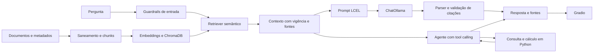

# CitizenTech Aurora — PAI

**Rodger Costa Rios — RM 571438 · Kenichi Caio Yamamoto — RM 569815 · 1CCPK · Dupla**

Frente D: serviço público essencial. Assistente para consultar horários, regras administrativas e acessibilidade de uma campanha municipal **inteiramente fictícia**. Não fornece indicação clínica, estoque nem agendamento.

## Estado da entrega

Implementação nova preparada. Execução com Ollama Cloud, métricas RAGAS, prints, conclusão, revisão humana da base e vídeo ainda precisam ser concluídos. O JSON inicial NÃO contém métricas medidas. Não entregar como versão final nesse estado.

## Executar no Colab

1. Abra `1_Notebook_GS2026_2.ipynb` como notebook no Google Colab. No painel **Arquivos**, abra a pasta `/content` e envie `PAI_NOVO_PREPARACAO.zip` para dentro dela, sem extrair. O caminho deve ficar `/content/PAI_NOVO_PREPARACAO.zip`, não na raiz `/`. A célula da seção 0 extrai o pacote automaticamente; como alternativa, coloque a pasta já extraída em `/content/2_base_documental`. **Não é necessário conectar o Google Drive:** se adicionou uma célula com `drive.mount`, pode excluí-la.
2. Adicione `OLLAMA_API_KEY` aos Secrets do Colab e autorize o notebook. Nunca cole a chave no código, em prints ou nesta documentação.
3. Leia e revise os documentos e as oito respostas `ground_truth` já preenchidas na seção 7. Foram redigidas com IA após o integrante informar autorização do professor, em exceção à regra do briefing. A autorização foi relatada pelo integrante e não verificada independentemente; preserve esse registro de autoria.
4. Confirme divisão de tarefas e links na seção 0. Use uma sessão nova e clique em **Ambiente de execução → Executar tudo**. A primeira execução baixa bibliotecas e embeddings; aguarde a conclusão e confira se alguma célula apresentou erro.
5. Confira respostas, chamadas de ferramentas, guardrails e métricas. Escreva a conclusão (até 15 linhas) com um resultado medido e uma melhoria fundamentada.
6. Salve o notebook COM as saídas, baixe o JSON gerado e atualize este README com números, interpretação e capturas reais. Os resultados do Colab não atualizam automaticamente os arquivos do seu computador.
7. Grave um vídeo de até 3 minutos com ambos se apresentando no início. Atualize `7_demo_video_url.txt` e a certificação. Entregue ZIP com os sete itens do briefing até 19/11/2026, 23h59.

## Fluxo

## Base e armadilha

DOC01 define o horário inicial. DOC02 altera o funcionamento a partir de 18/11: NORTE fecha, CENTRO reduz horário e só recebe pessoas de 60+ aos sábados. DOC03 contém o detalhe do acesso com rampa no corpo do texto e um anexo estruturado dos horários. A nova publicação prevalece apenas durante sua vigência e nos pontos alterados. Os três textos são rascunhos inéditos produzidos com assistência de IA e exigem revisão da dupla.

## Decisões técnicas

- Embeddings multilíngues locais: `paraphrase-multilingual-MiniLM-L12-v2`, adequados a buscas semânticas em português, sem chave adicional.
- Duas estratégias: 500/50 e 1000/150 caracteres. A escolha é medida pela cobertura documental de três consultas de desenvolvimento, com desempate pelo menor contexto. Essa medida NÃO é RAGAS.
- Recuperação `k=4`, distância cosseno e limiar inicial 0,85, não calibrado como confiança probabilística. Expansão inclui regulamento e alteração relacionados para não esconder contradições. A expansão aumenta contexto e pode reduzir precisão; avaliar esse efeito.
- LCEL real com prompt, ChatOllama e parser. Modelo e juiz: `gpt-oss:120b-cloud` na Ollama Cloud. Credencial somente nos Secrets. O modelo pode variar conforme disponibilidade da conta, mas qualquer troca precisa ser registrada.
- Duas ferramentas: `consultar_status_unidade` e `calcular_proximo_horario`. As regras vêm do anexo documental. O modelo escolhe as chamadas; o código valida e calcula. Limite de seis chamadas, erros controlados, sem reserva de vagas.
- O trace registra nome, argumentos e observações das ferramentas, não raciocínio privado do modelo.
- Histórico Gradio é visível e restrito à sessão. Cada pergunta deve ser autossuficiente; o histórico anterior não é enviado ao modelo.

## Segurança e limitações

Filtro de escopo, bloqueio de dados pessoais/identificação de pacientes, saneamento de injeção em documentos, instruções de precedência no prompt e validação de citações. Há demonstrações de ataque inserido em documento e de pergunta sem informação na base. Filtros são defesa parcial, não garantia de imunidade. Uma citação válida não prova que todas as afirmações estão corretas; a avaliação humana e RAGAS continuam necessárias.

O programa considera uma agenda fictícia de novembro de 2026, sem feriados adicionais, estoque ou capacidade de atendimento. Não oferece orientação de saúde individual. As consultas usam apenas dados sintéticos. A proteção por expressões pode falhar com ataques reformulados. Datas e idades devem ser fornecidas explicitamente para cálculos.

## Avaliação e evidências

Oito perguntas (quatro simples e quatro com armadilhas), referências redigidas com IA sob autorização informada pelo integrante, pendentes de revisão da dupla e quatro métricas RAGAS: faithfulness, answer_relevancy, context_precision e context_recall. O juiz e os embeddings são configurados explicitamente. Falhas de medição ficam como valores nulos e estado parcial, nunca como pontuação inventada. Metas do briefing orientam a análise, não são garantia de nota.

**Resultados medidos:** pendentes. **Interpretação e melhoria ligada a uma métrica:** pendentes.

Inserir capturas REAIS de: comparação de chunking; coleção e distância; três respostas com fonte e ausência de informação; chamada de ferramentas; interface Gradio; cada guardrail; tabela RAGAS; tela final. As saídas do notebook também precisam permanecer salvas. Não há prints simulados neste pacote.

## Custo e produção

RAG: uma chamada ao modelo por resposta após os filtros. Agente: até sete chamadas ao modelo e seis execuções locais de ferramenta. RAGAS faz várias chamadas de juiz por pergunta e também usa embeddings; pode atingir limites gratuitos. Os modelos de embeddings baixam na primeira execução. Não há configuração de API paga. Produção exigiria base real autorizada, vigência monitorada, avaliação contínua, proteção de dados e infraestrutura própria.

## Referências técnicas

- [ChatOllama e tool calling](https://reference.langchain.com/python/langchain-ollama/chat_models/ChatOllama)
- [Ollama Python e acesso Cloud](https://github.com/ollama/ollama-python)
- [RAGAS: integração LangChain](https://github.com/vibrantlabsai/ragas/blob/main/docs/howtos/integrations/langchain.md)
- Enunciado GS2026.2 de Prompt and Artificial Intelligence enviado pela equipe.

## Vídeo e divisão de tarefas

Vídeo: pendente. Divisão real das tarefas: confirmar pela dupla. Uso de IA documentado em `6_Chat_Log.txt`.
