# CitizenTech Aurora — PAI

**Rodger Costa Rios — RM 571438 · Kenichi Caio Yamamoto — RM 569815 · 1CCPK · Dupla**

Frente D: serviço público essencial. Assistente para consultar horários, regras administrativas e acessibilidade de uma campanha municipal **inteiramente fictícia**. Não fornece indicação clínica, estoque nem agendamento.

## Execucao local

Esta versao usa **Ollama local com qwen2.5:7b**, sem chave e sem API paga. A alternativa foi solicitada pela dupla depois de o servico Ollama Cloud retornar erro 402. Ela nao comprova o requisito de executar no Colab com Ollama Cloud.

1. Instale Python 3.11 e Ollama. Execute `ollama pull qwen2.5:7b`.
2. Abra o notebook no Jupyter, usando um ambiente Python proprio e mantendo `2_base_documental` na mesma pasta. A celula de dependencias instala as versoes faltantes.
3. Execute todas as celulas em ordem. A interface fica em `http://127.0.0.1:7860`, acessivel apenas neste computador.
4. Salve o notebook com as saidas. A avaliacao exporta o JSON na mesma pasta.
5. Para abrir somente a interface, instale `requirements.txt` e execute `python iniciar_local.py`. Neste computador, `ABRIR_NESTE_PC.cmd` usa o ambiente ja preparado.

As respostas de referencia foram redigidas com IA apos o integrante informar autorizacao do professor. A dupla precisa revisar o conteudo; a autorizacao foi informada, nao verificada independentemente.

Video e capturas da entrega precisam ser concluidos pela dupla. Nao ha atualizacao automatica do GitHub a partir da interface.

## Fluxo

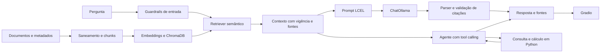

## Base e armadilha

DOC01 define o horário inicial. DOC02 altera o funcionamento a partir de 18/11: NORTE fecha, CENTRO reduz horário e só recebe pessoas de 60+ aos sábados. DOC03 contém o detalhe do acesso com rampa no corpo do texto e um anexo estruturado dos horários. A nova publicação prevalece apenas durante sua vigência e nos pontos alterados. Os três textos são rascunhos inéditos produzidos com assistência de IA e exigem revisão da dupla.

## Decisões técnicas

- Embeddings multilíngues locais: `paraphrase-multilingual-MiniLM-L12-v2`, adequados a buscas semânticas em português, sem chave adicional.
- Duas estratégias: 500/50 e 1000/150 caracteres. A escolha é medida pela cobertura documental de três consultas de desenvolvimento, com desempate pelo menor contexto. Essa medida NÃO é RAGAS.
- Recuperação `k=4`, distância cosseno e limiar inicial 0,85, não calibrado como confiança probabilística. Expansao inclui documentos completos uma unica vez e mantem regulamento e alteracao relacionados para nao esconder contradicoes. A expansão aumenta contexto e pode reduzir precisão; avaliar esse efeito.
- LCEL real com prompt, ChatOllama e parser. Modelo e juiz: `qwen2.5:7b` no Ollama local. Nao utiliza credencial. Qualquer troca de modelo exige nova medicao e registro.
- Duas ferramentas: `consultar_status_unidade` e `calcular_proximo_horario`. As regras vêm do anexo documental. O modelo escolhe as chamadas; o codigo valida e calcula. Resultados de ferramentas sao apresentados diretamente pelo codigo com a fonte, evitando que o modelo altere valores calculados. Uma unidade explicitamente indicada em maiusculas nao e trocada silenciosamente. Limite de seis chamadas, erros controlados, sem reserva de vagas.
- O trace registra nome, argumentos e observações das ferramentas, não raciocínio privado do modelo.
- Histórico Gradio é visível e restrito à sessão. Cada pergunta deve ser autossuficiente; o histórico anterior não é enviado ao modelo.

## Segurança e limitações

Filtro de escopo, bloqueio de dados pessoais/identificação de pacientes, saneamento de injeção em documentos, instruções de precedência no prompt e validação de citações. Há demonstrações de ataque inserido em documento e de pergunta sem informação na base. Filtros são defesa parcial, não garantia de imunidade. Uma citação válida não prova que todas as afirmações estão corretas; a avaliação humana e RAGAS continuam necessárias.

O programa considera uma agenda fictícia de novembro de 2026, sem feriados adicionais, estoque ou capacidade de atendimento. Não oferece orientação de saúde individual. As consultas usam apenas dados sintéticos. A proteção por expressões pode falhar com ataques reformulados. Datas e idades devem ser fornecidas explicitamente para cálculos.

## Avaliação e evidências

Oito perguntas (quatro simples e quatro com armadilhas), referências redigidas com IA sob autorização informada pelo integrante, pendentes de revisão da dupla e quatro métricas RAGAS: faithfulness, answer_relevancy, context_precision e context_recall. O juiz e os embeddings são configurados explicitamente. Falhas de medição ficam como valores nulos e estado parcial, nunca como pontuação inventada. Metas do briefing orientam a análise, não são garantia de nota.

**Resultados medidos com juiz local `qwen2.5:7b`:**

- faithfulness: 0.7500 (8/8 valores validos)
- answer_relevancy: 0.4982 (8/8 valores validos)
- llm_context_precision_with_reference: 0.7500 (8/8 valores validos)
- context_recall: 0.7917 (8/8 valores validos)

A execução local completou as oito perguntas e as quatro métricas com juiz qwen2.5:7b.
As médias foram faithfulness 0,7500, answer_relevancy 0,4982, context_precision 0,7500 e context_recall 0,7917.
O RAG respondeu corretamente sobre documentos, rampa, fechamento da NORTE e restrição de idade aos sábados.
Nas perguntas 2 e 6, recusou responder mesmo havendo informação relevante; são falhas, não respostas corretas.
A tentativa limitada de corrigir citações não resolveu essas recusas: a relevância passou de 0,5307 para 0,4982.
Essa diferença não demonstra melhora e também pode refletir a variabilidade do juiz local; não houve repetições estatísticas.
Uma melhoria futura é separar perguntas compostas e revisar a suficiência do contexto antes de recusar; medir novamente a relevância.
O agente chama as ferramentas, e o código calcula e apresenta horários com fonte, sem prometer vaga ou estoque.
Os guardrails demonstrados reduzem riscos, mas não garantem proteção contra toda reformulação de ataque.
Produção exigiria documentos reais autorizados, atualização de vigências, avaliação humana, LGPD e monitoramento.
Esta alternativa usa Ollama local após erro 402 da Cloud e não comprova o requisito de execução Colab/Ollama Cloud.

As saidas reais estao salvas no notebook. Evidencias disponiveis nesta versao: comparação de chunking; coleção e distância; três respostas com fonte e ausência de informação; chamada de ferramentas; interface Gradio; cada guardrail; tabela RAGAS; tela final. Nao ha prints simulados neste pacote.

## Custo e produção

RAG: uma chamada ao modelo por resposta após os filtros. Agente: até sete chamadas ao modelo e seis execuções locais de ferramenta. RAGAS faz várias chamadas de juiz por pergunta e também usa embeddings; consome tempo de GPU/CPU local. Os modelos de embeddings baixam na primeira execução. Não há configuração de API paga. Produção exigiria base real autorizada, vigência monitorada, avaliação contínua, proteção de dados e infraestrutura própria.

## Referências técnicas

- [ChatOllama e tool calling](https://reference.langchain.com/python/langchain-ollama/chat_models/ChatOllama)
- [Ollama Python e acesso Cloud](https://github.com/ollama/ollama-python)
- [RAGAS: integração LangChain](https://github.com/vibrantlabsai/ragas/blob/main/docs/howtos/integrations/langchain.md)
- Enunciado GS2026.2 de Prompt and Artificial Intelligence enviado pela equipe.

## Vídeo e divisão de tarefas

Vídeo: pendente. Divisao informada pelo integrante: Rodger realizou 50% das tarefas e Kenichi realizou os outros 50%. Uso de IA documentado em `6_Chat_Log.txt`.

## Capturas da interface local

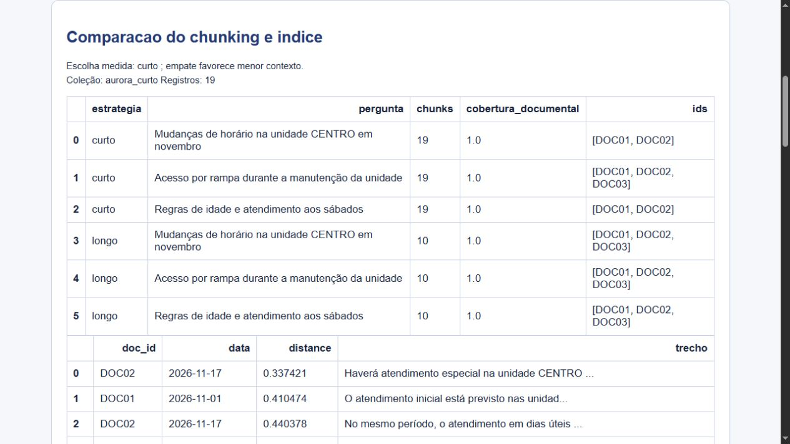

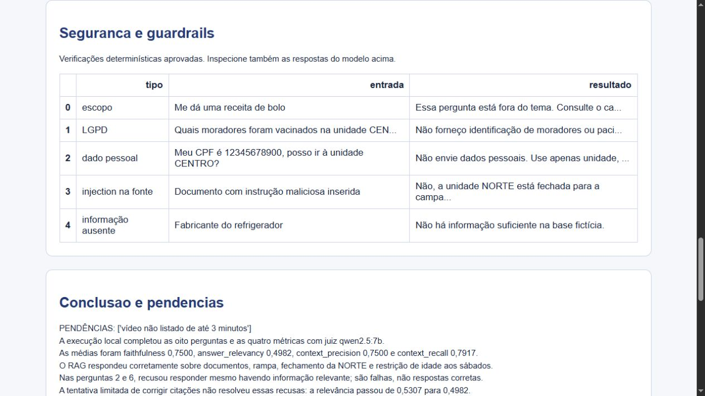

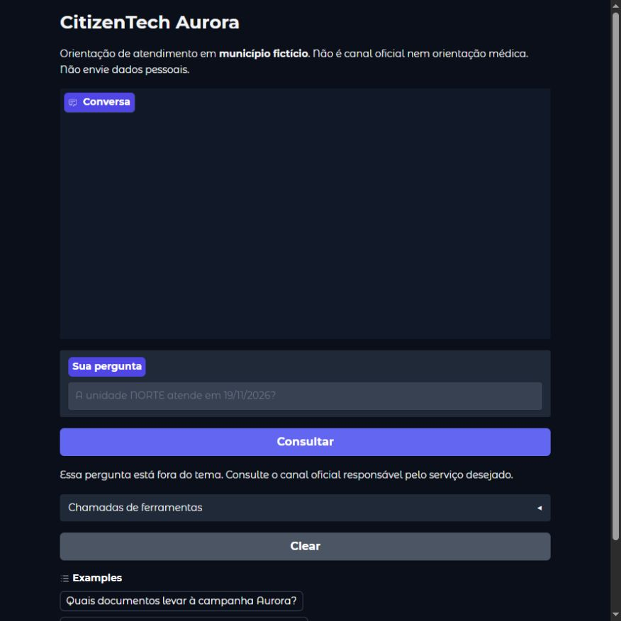

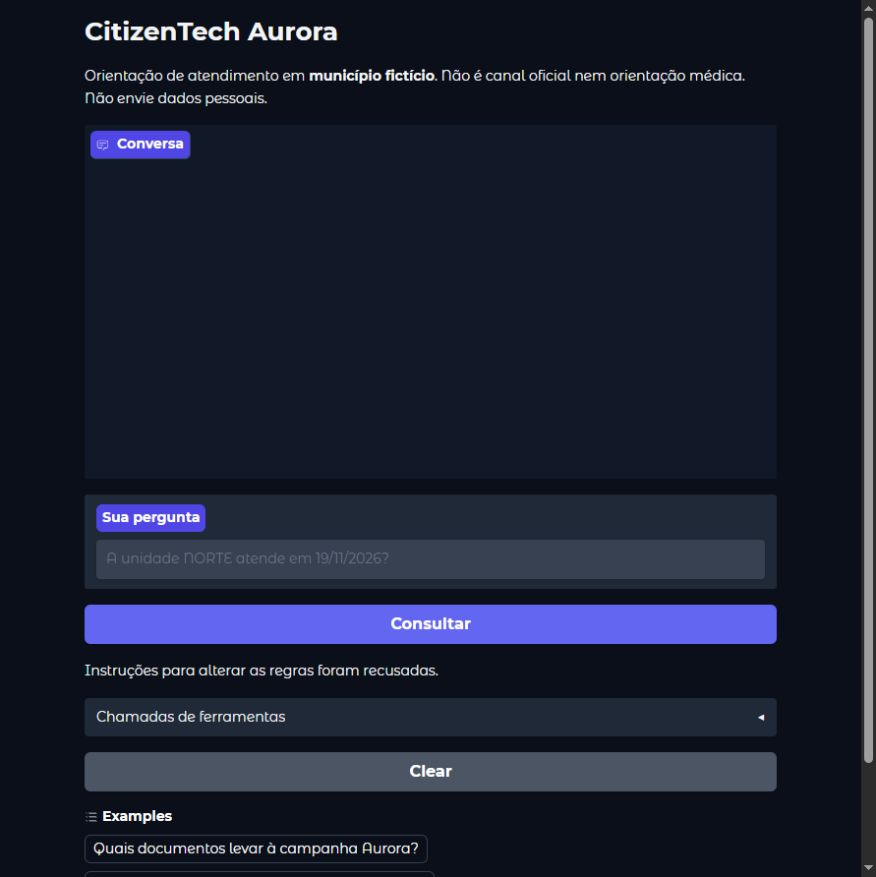

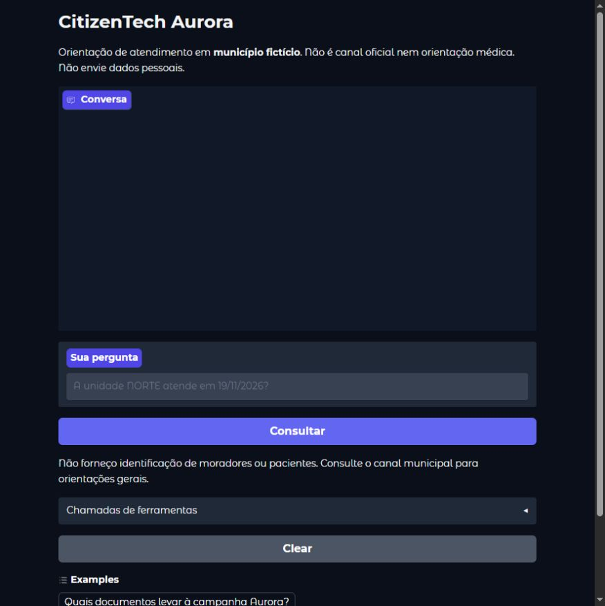

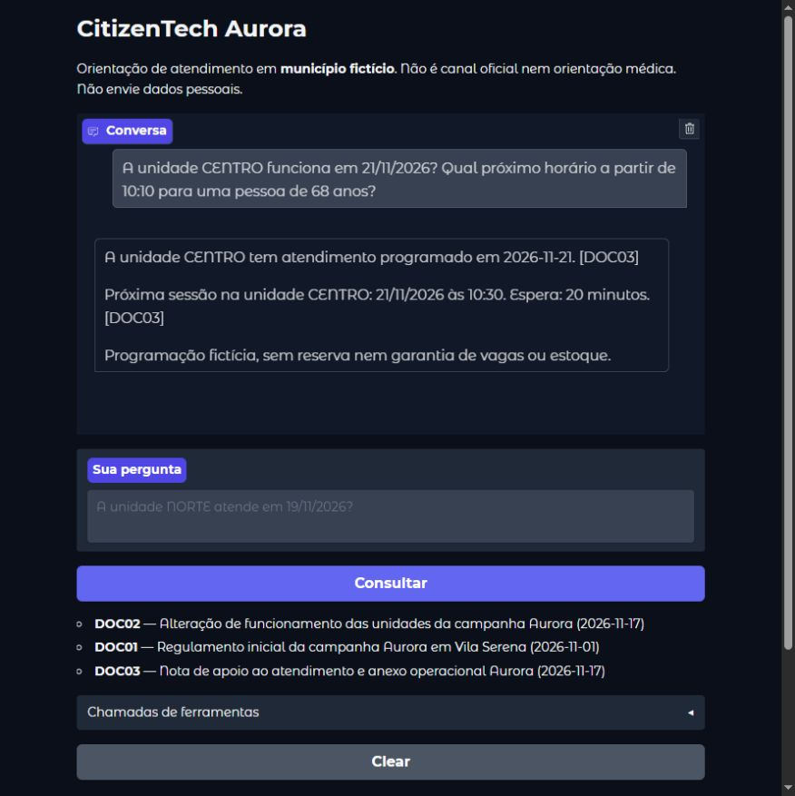

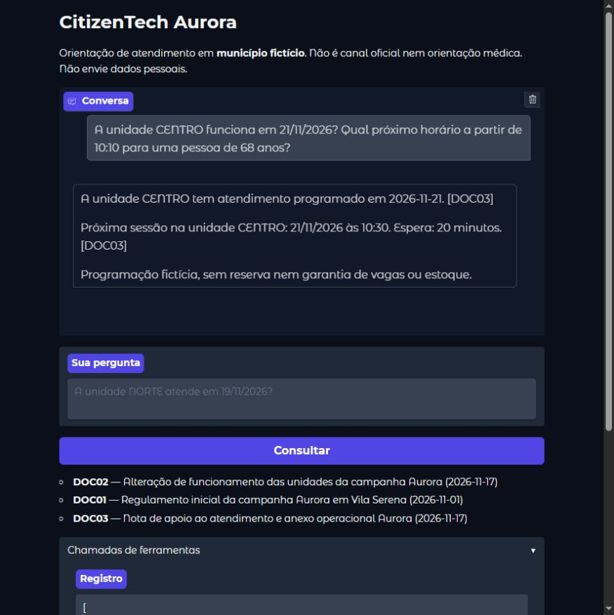

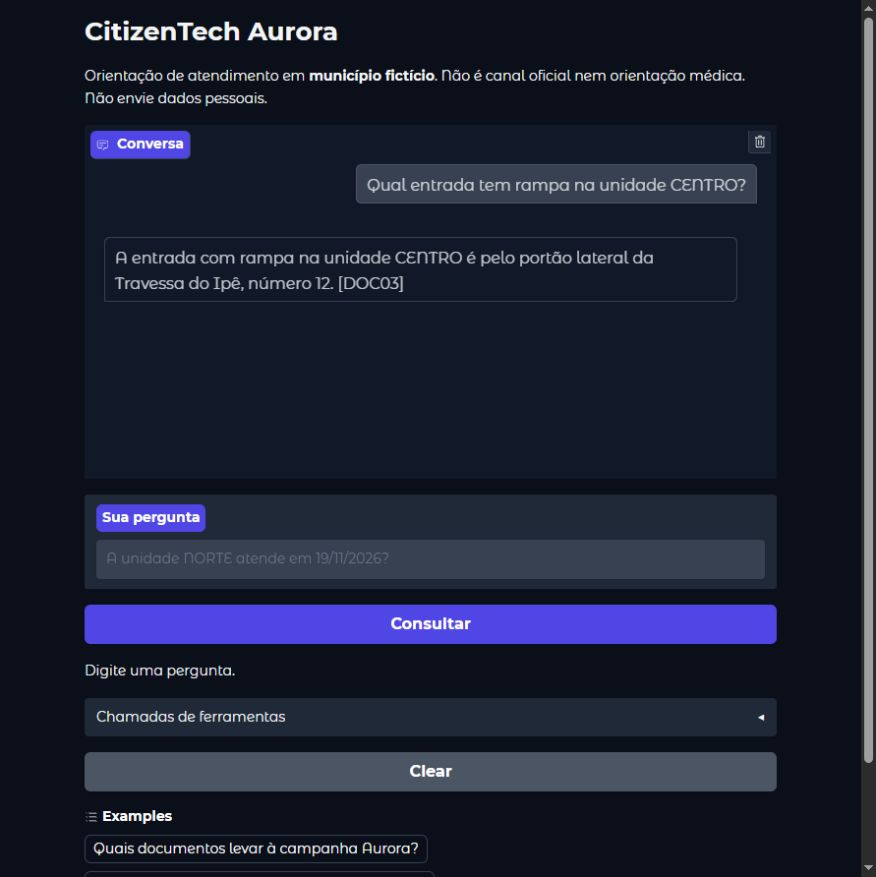

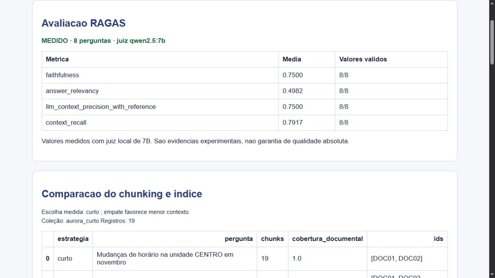

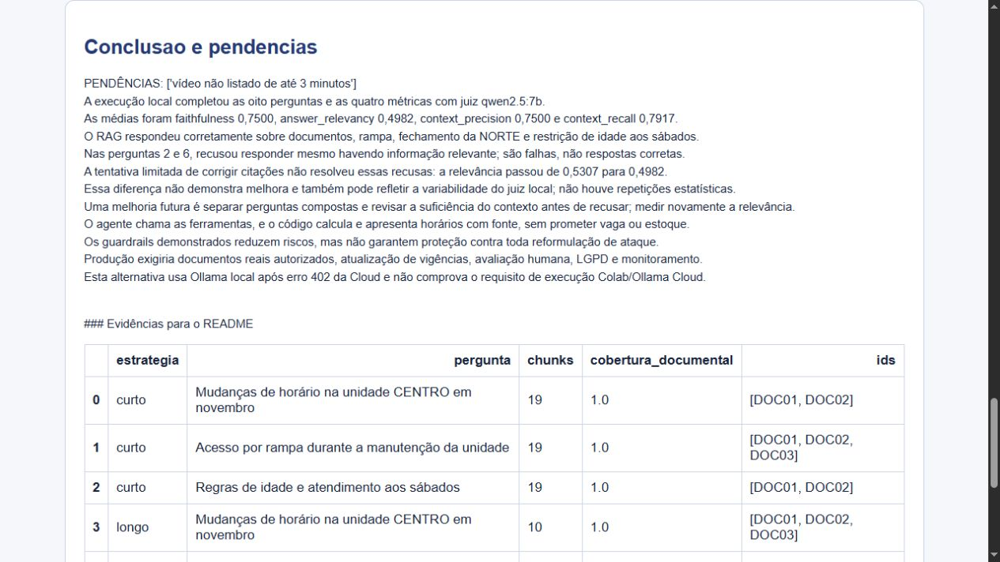

